# PUSTIPADA WorkHub

**PUSTIPADA WorkHub** adalah sistem manajemen tugas, kolaborasi tim, dan pelaporan kinerja berbasis web yang dirancang untuk mendukung operasional internal Pusat Teknologi Informasi dan Pangkalan Data (PUSTIPADA), sekaligus berfungsi sebagai **pusat penyimpanan (repositori terpadu) bagi seluruh tugas yang pernah dibuat beserta lampiran bukti kerja dan riwayat perubahan statusnya**. Sistem ini mengintegrasikan alur kerja berbasis peran (*Role-Based Access Control*), validasi transisi status tugas (*State Machine*), pelampiran bukti kerja (*Work Proof Submissions*), pencatatan jejak audit status (*Audit Trail*), kalender agenda internal, notifikasi *in-app*, serta *export* laporan kinerja dalam arsitektur yang sepenuhnya terkontainerisasi (*Full-Dockerized*).

## 1. Deskripsi Aplikasi

PUSTIPADA WorkHub hadir untuk menggantikan pencatatan instruksi kerja manual yang tersebar di berbagai kanal komunikasi menjadi satu platform terpusat yang akuntabel dan transparan.

### Fitur Utama:

* **Manajemen Tugas & *State Machine*:** Mendukung siklus hidup tugas secara terstruktur mulai dari `Draft`, `Open`, `In Progress`, `In Review`, `Revision Needed`, `Completed`, hingga `Cancelled`.

## Application Preview
### 1. Authentication

**Login Page**

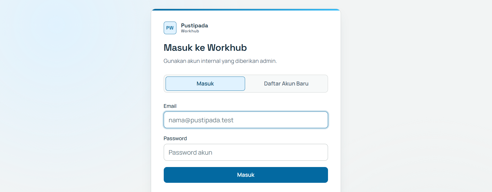

**Register Page**

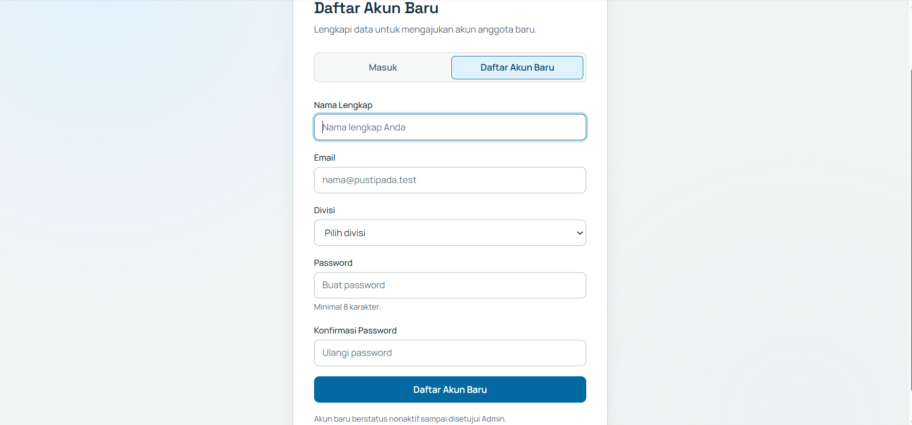

### 2. Admin

**Dashboard Page**

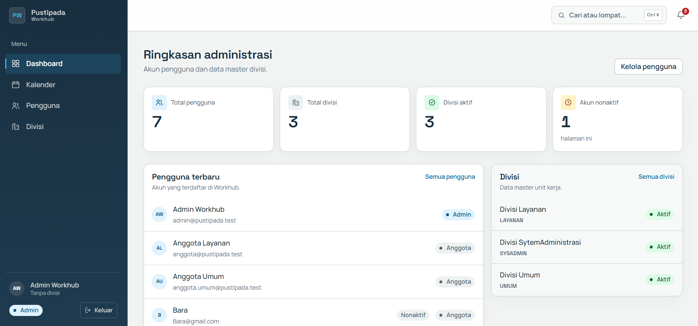

**Pengguna Page**

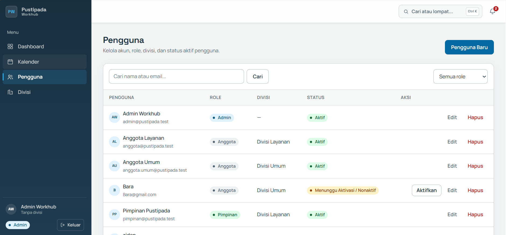

**Tambah Pengguna**

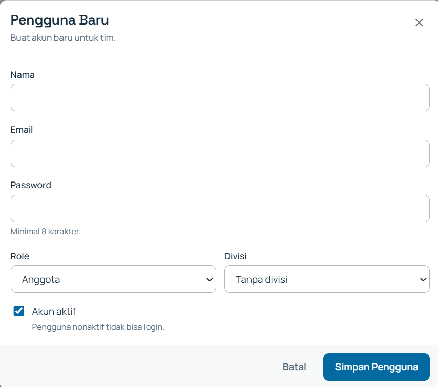 

**Kalender Page**

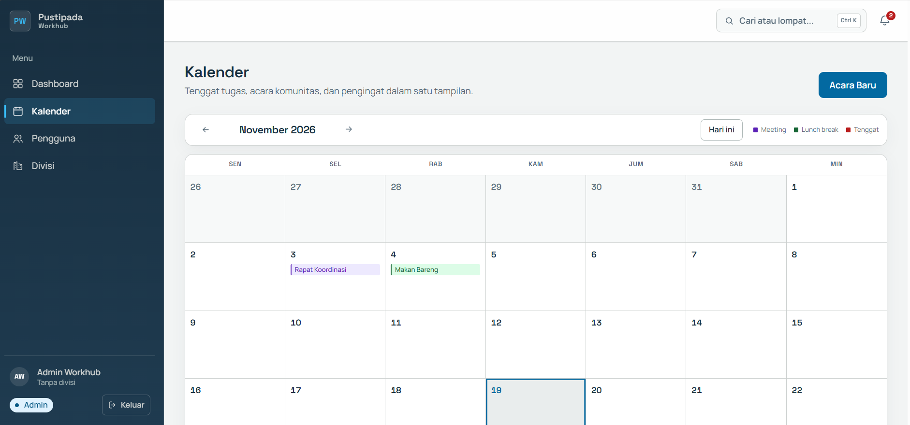

**Divisi page**

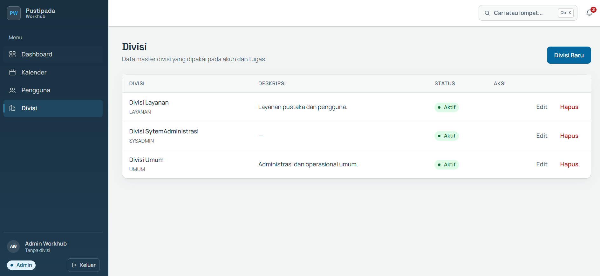

**Tambah Divisi**

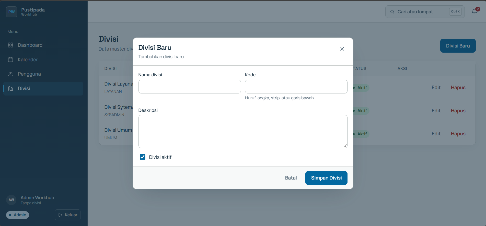


### 3. Pimpinan

**Dashboard page**

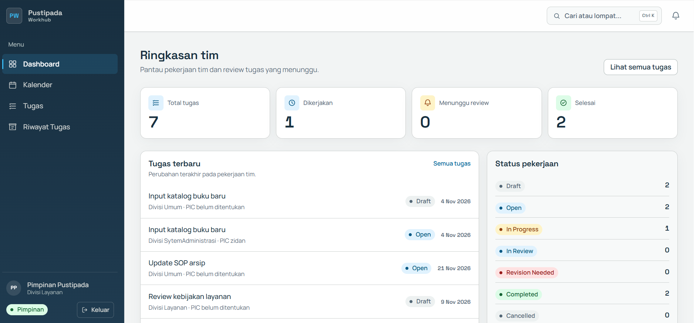

**Kalender Page**

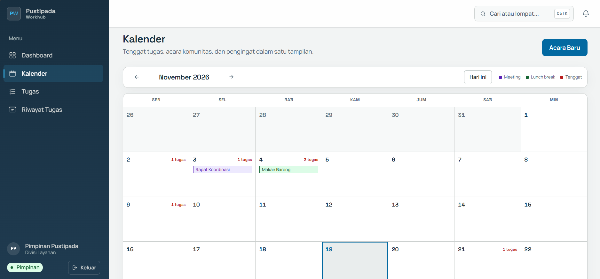

**Tambah Acara Oleh Pimpinan**


**Tugas page**

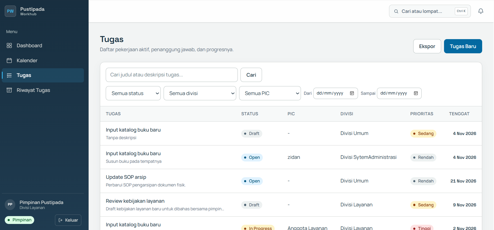

**Tambah Tugas**

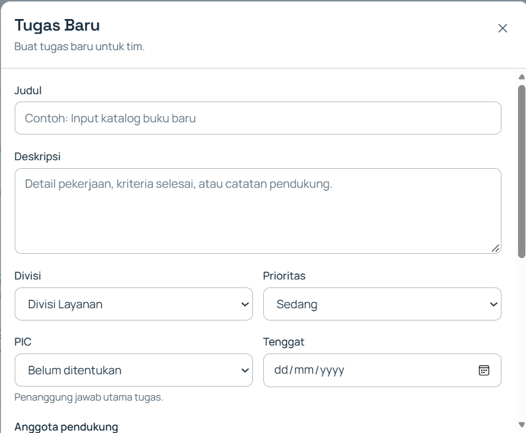

**Tambah Anggota Pendukung Tugas**

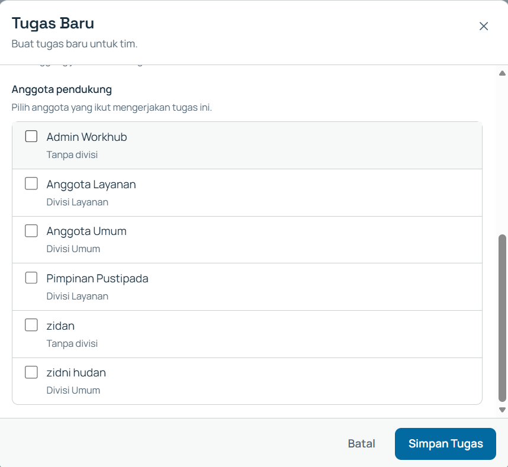

**Lihat Tugas**

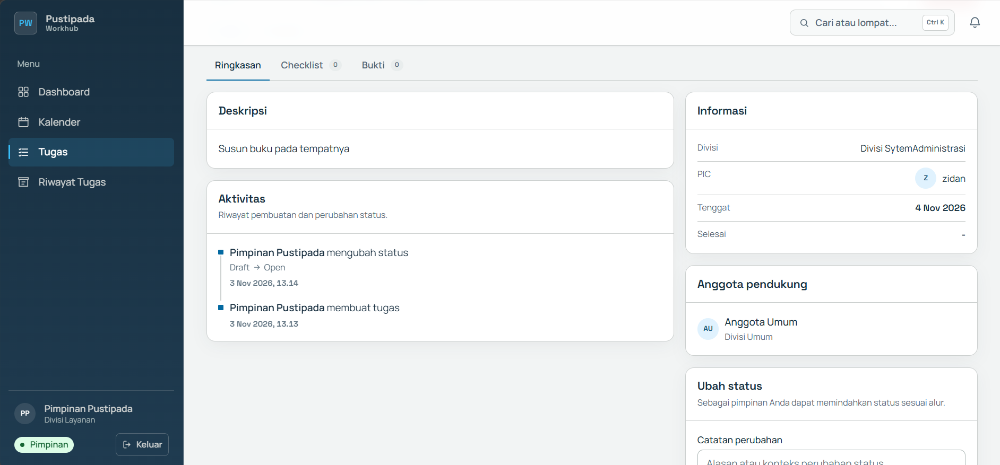

**Riwayat Tugas Page**

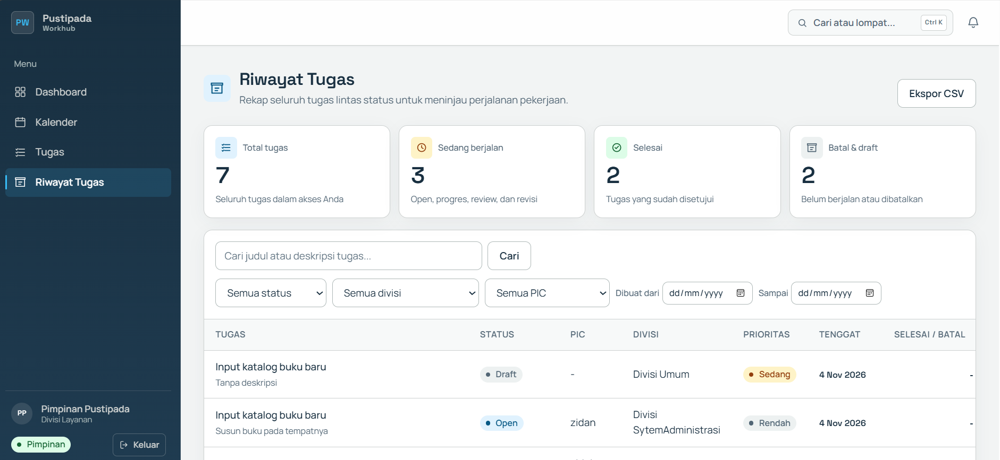

### 4. Anggota

**Dashboard Page**

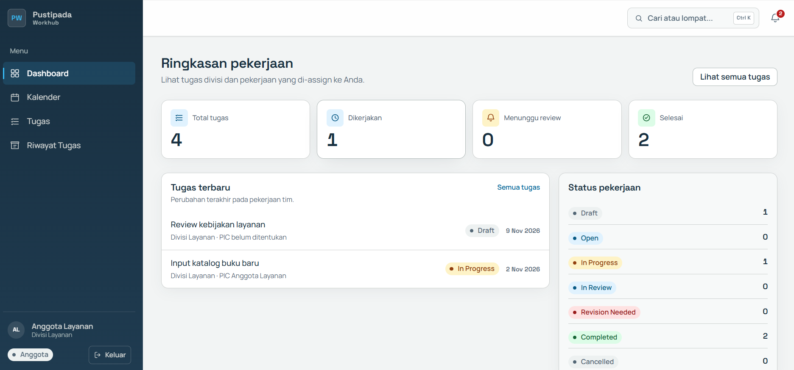

**Kalender Page**


**Tugas Page**

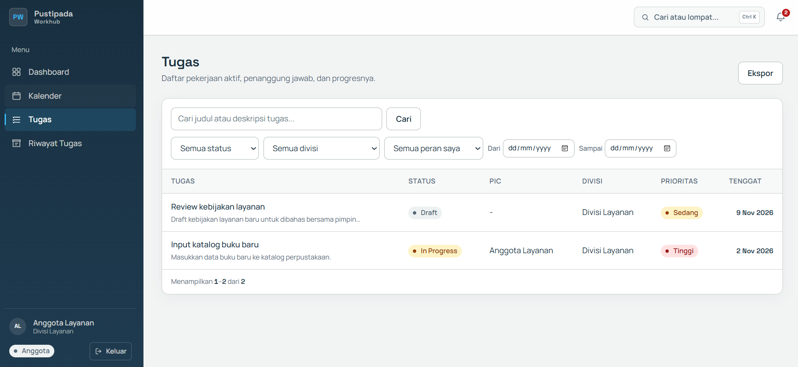

**Riwayat Tugas Page**

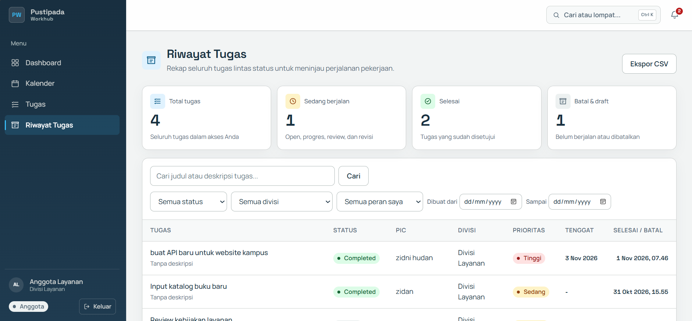

### 5. Notification

**Notification**

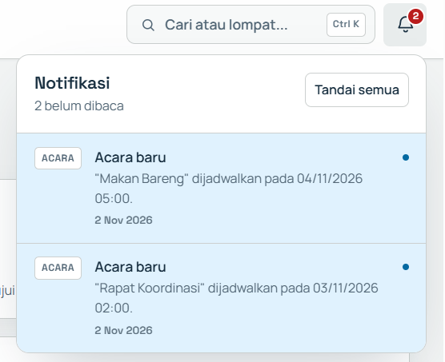

* **Penunjukan PIC & Pembagian Anggota:** Pimpinan/Admin dapat menunjuk 1 Anggota sebagai *Person in Charge* (PIC) utama sekaligus menambahkan anggota tim pendukung.

* **Submisi Bukti Kerja (*Work Proof*):** Anggota wajib melampirkan berkas dokumen, gambar, atau tautan bukti penyelesaian sebelum tugas dapat ditinjau oleh Pimpinan.

* **Riwayat Aktivitas (*Audit Trail*):** Mencatat setiap perubahan status, catatan revisi, dan log aktivitas pengguna secara kronologis.

* **Kalender Agenda & Notifikasi *In-App*:** Menampilkan jadwal kegiatan divisi serta memberikan pemberitahuan *real-time* terkait penugasan dan evaluasi.

* **Laporan Kinerja:** Rekapitulasi dan *export* data kinerja individu maupun divisi berdasarkan periode waktu tertentu.

## 2. Teknologi yang Digunakan

Aplikasi ini dibangun menggunakan arsitektur *decoupled* di mana seluruh layanan berjalan secara terisolasi di dalam kontainer Docker:

* **Frontend Container (Presentation Tier):**

  * **React + TypeScript** (Single Page Application)

  * **Vite** (Build Tool & Dev/Preview Server)

  * **Tailwind CSS** (Styling & Desain Antarmuka *Deep Navy Slate*)

  * **Zustand** (State Management) & **Axios** (HTTP Client)

* **Backend Container (Application Tier):**

  * **Laravel** (RESTful API Framework)

  * **Laravel Sanctum** (Autentikasi berbasis Bearer Token & Otorisasi RBAC)

* **Database Container (Data Tier):**

  * **PostgreSQL 15+** (Relational Database Management System dengan *Persistent Volume*)

* **Infrastructure & Orchestration:**

  * **Docker & Docker Compose** (Isolasi dan orkestrasi jaringan internal antar-kontainer)

## 3. Persyaratan Instalasi

Karena seluruh dependensi (PHP, Composer, Node.js, dan PostgreSQL) sudah dikemas di dalam *image* Docker, Anda **tidak perlu** menginstal PHP maupun Node.js secara manual di komputer *host*. Pastikan hanya perangkat lunak berikut yang terpasang:

1. **Git** (versi 2.30 atau terbaru)

2. **Docker Desktop** (Windows/macOS) atau **Docker Engine + Docker Compose** (Linux)

3. **Web Browser** modern (Google Chrome, Mozilla Firefox, atau Microsoft Edge)

## 4. Cara Clone Repository

Buka terminal atau *Command Prompt*, lalu jalankan perintah berikut untuk mengunduh kode sumber proyek dari repositori Git:

```
# Clone repository proyek
git clone https://github.com/username-anda/pustipada-workhub.git

# Masuk ke direktori utama proyek
cd pustipada-workhub

```

*(Catatan: Sesuaikan URL repositori dengan alamat GitHub/GitLab proyek Anda. Pastikan file `docker-compose.yml` berada di direktori utama atau sesuai struktur folder proyek).*

## 5. Konfigurasi Environment

Sebelum menjalankan kontainer, salin dan sesuaikan berkas konfigurasi lingkungan (`.env`) untuk masing-masing layanan.

### 5.1 Konfigurasi Backend (`backend/.env`)

Salin berkas contoh `.env.example` menjadi `.env`:

```
cp backend/.env.example backend/.env

```

Buka file `backend/.env` dan pastikan konfigurasi koneksi database mengarah ke nama *service* PostgreSQL di dalam jaringan Docker (misalnya `db` atau `postgres`):

```
APP_NAME="PUSTIPADA WorkHub"
APP_ENV=local
APP_KEY=
APP_DEBUG=true
APP_URL=http://localhost:8000

FRONTEND_URL=http://localhost:5173

DB_CONNECTION=pgsql
DB_HOST=db
DB_PORT=5432
DB_DATABASE=pustipada_workhub
DB_USERNAME=postgres
DB_PASSWORD=secret_password

FILESYSTEM_DISK=public

```

### 5.2 Konfigurasi Frontend (`frontend/.env`)

Salin berkas contoh `.env.example` menjadi `.env` pada direktori frontend:

```
cp frontend/.env.example frontend/.env

```

Pastikan variabel URL API mengarah ke *endpoint* backend Laravel yang terekspos dari kontainer:

```
VITE_API_BASE_URL=http://localhost:8000/api/v1
VITE_APP_NAME="PUSTIPADA WorkHub"

```

## 6. Cara Menjalankan Docker

Seluruh layanan (**Frontend**, **Backend**, dan **Database**) dijalankan secara bersamaan melalui satu perintah orkestrasi **Docker Compose**.

### 6.1 Membangun dan Menjalankan Semua Kontainer

Dari direktori utama proyek (tempat file `docker-compose.yml` berada), jalankan perintah:

```
# Build image dan jalankan seluruh kontainer di latar belakang (detached mode)
docker compose up -d --build

```

### 6.2 Memeriksa Status Kontainer

Pastikan seluruh kontainer (`frontend`, `backend`/`app`, dan `db`) berstatus `Up` atau `Running`:

```
docker compose ps

```

Untuk melihat log aktivitas seluruh kontainer secara *real-time*:

```
docker compose logs -f

```

## 7. Cara Melakukan Migration Database

Setelah seluruh kontainer berjalan dengan normal, jalankan perintah Artisan di dalam kontainer backend untuk membuat *Application Key*, menjalankan migrasi tabel PostgreSQL, mengisi data awal (*seeder*), serta menautkan *storage* bukti kerja:

```
# 1. Generate Laravel Application Key
docker compose exec backend php artisan key:generate

# 2. Jalankan migrasi tabel database dan seeder data awal
docker compose exec backend php artisan migrate --seed

# 3. Buat symbolic link agar file bukti kerja dapat diakses/diunduh
docker compose exec backend php artisan storage:link

```

*(Catatan: Sesuaikan nama service `backend` di atas dengan nama service Laravel yang didefinisikan pada file `docker-compose.yml` Anda, misalnya `app` atau `api`).*

## 8. Alamat Akses Aplikasi

Setelah proses instalasi dan migrasi selesai, seluruh layanan yang berjalan di dalam kontainer Docker dapat diakses melalui *port* yang dipetakan ke *localhost*:

| Komponen Layanan | Alamat Akses (URL / Host) | Keterangan | 
| ----- | ----- | ----- | 
| **Aplikasi Web (Frontend)** | `http://localhost:5173` | Antarmuka utama PUSTIPADA WorkHub (React + TS) | 
| **REST API (Backend)** | `http://localhost:8000/api/v1` | Endpoint API Laravel | 
| **Database PostgreSQL** | `localhost:5432` | Koneksi klien database eksternal (DBeaver / pgAdmin) | 

### Akun Default Hasil Seeder (Pengujian):

* **Admin:** `admin@pustipada.ac.id` | Password: `password123`

* **Pimpinan:** `pimpinan@pustipada.ac.id` | Password: `password123`

* **Anggota:** `anggota@pustipada.ac.id` | Password: `password123`

## 9. Troubleshooting

Berikut adalah beberapa kendala umum yang mungkin ditemui saat menjalankan lingkungan *full-Docker* beserta solusinya:

### 9.1 Port Sudah Digunakan (`Bind for 0.0.0.0:xxxx failed: port is already allocated`)

* **Penyebab:** Port `5173`, `8000`, atau `5432` sedang dipakai oleh layanan lokal lain di komputer *host* (misalnya PostgreSQL atau server web lokal di luar Docker).

* **Solusi:** Hentikan layanan lokal yang menggunakan port tersebut, atau ubah pemetaan port pada file `docker-compose.yml` (contoh: mengubah `"5432:5432"` menjadi `"5433:5432"`).

### 9.2 Koneksi Database Ditolak (`SQLSTATE[08006] Connection refused`)

* **Penyebab:** Perintah `php artisan migrate` dijalankan terlalu cepat sebelum kontainer PostgreSQL siap menerima koneksi, atau `DB_HOST` di `backend/.env` masih bernilai `127.0.0.1` alih-alih nama *service* Docker (`db`).

* **Solusi:** Pastikan `DB_HOST=db` pada `backend/.env`, tunggu 5–10 detik hingga kontainer database siap (`docker compose logs db`), lalu jalankan ulang `docker compose exec backend php artisan migrate --seed`.

### 9.3 Perubahan Paket (`package.json` / `composer.json`) Tidak Terdeteksi

* **Penyebab:** *Docker image* masih menggunakan *cache* lapisan (*layer*) lama sebelum dependensi baru ditambahkan.

* **Solusi:** Bangun ulang kontainer terkait tanpa *cache* dengan perintah:

  ```
  docker compose up -d --build --force-recreate
  
  ```

### 9.4 Error Izin Akses Folder (`Permission Denied` pada `storage/` atau `bootstrap/cache/`)

* **Penyebab:** Pengguna *web server* (`www-data`) di dalam kontainer Linux tidak memiliki izin tulis ke direktori penyimpanan atau *cache* Laravel.

* **Solusi:** Jalankan perintah perbaikan hak akses di dalam kontainer backend:

  ```
  docker compose exec backend chown -R www-data:www-data storage bootstrap/cache
  docker compose exec backend chmod -R 775 storage bootstrap/cache
  
  ```

### 9.5 Kendala CORS (`Blocked by CORS policy`)

* **Penyebab:** Origin frontend (`http://localhost:5173`) belum sesuai dengan konfigurasi `FRONTEND_URL` di `backend/.env`.

* **Solusi:** Pastikan `FRONTEND_URL=http://localhost:5173` sudah benar, lalu bersihkan *cache* konfigurasi Laravel:

  ```
  docker compose exec backend php artisan config:clear
  
  ```